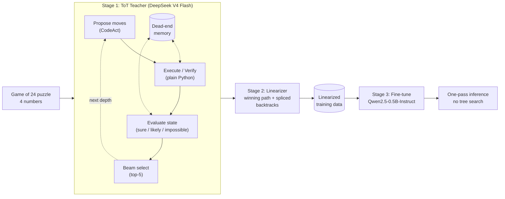

<p align="center">
  
  
  
  
  
</p>

Implementation of the Tree-of-Thoughts teacher, linearizer and small-language-model student for the paper:

### [Distilling Tree-of-Thought Reasoning into Small Language Models via Prompt-Guided Imitation](https://YOUR-PAPER-LINK)

[Tasnuba Mehjabin](https://github.com/YOUR-USERNAME)\*, [Shah Faiyaz Zaman](https://github.com/YOUR-USERNAME)\*, [MD Mahmudun Nur Miraz](https://github.com/YOUR-USERNAME), [Mubtasim Kamal Dihan](https://github.com/YOUR-USERNAME), [Moin Mostakim](https://github.com/YOUR-USERNAME)

<sub>\* Equal contribution. The first and second authors implemented the code and ran the experiments in this repository.</sub>
<br>
<sub>Dept. of CSE, BRAC University, Dhaka, Bangladesh &nbsp;|&nbsp; Mubtasim Kamal Dihan: Dept. of CSE, Islamic University of Technology, Dhaka, Bangladesh</sub>

<p align="center">
  
</p>

---

## Overview

Chain-of-Thought (CoT) prompting is linear: if an early step goes wrong, the model cannot recover. **Tree of Thoughts (ToT)** fixes this by exploring several reasoning paths, scoring partial states, and backtracking, but it needs many expensive LLM calls, so it is impractical for small language models (SLMs).

We ask: **can a full multi-step ToT search, including its failed branches, be turned into one linear training trace that a sub-1B model can imitate with no tree search at inference time?**

Our teacher-student framework, evaluated on the **Game of 24**, has three stages:

1. **Teacher.** DeepSeek V4 Flash (non-thinking mode) runs a real ToT search. Every move is proposed as executable Python (CodeAct), verified by code, scored, and pruned with a **dead-end memory**.
2. **Linearizer.** Each solved tree becomes a single sequence: the winning path, with abandoned sibling branches spliced in as explicit `Backtrack (to: ...)` steps.
3. **Student.** Qwen2.5-0.5B-Instruct is fully fine-tuned on these traces and solves puzzles in a single pass.



## Method

**Stage 1: Multi-step ToT teacher**
- **Propose:** 12 candidate moves for 4-number states, 8 for 3-number states. For 2-number states, all six outcomes `{a+b, a-b, b-a, a*b, a/b, b/a}` are pre-computed.
- **Execute and verify (CodeAct):** plain Python hard-prunes duplicate states and proves 2-number dead ends, with no LLM call.
- **Evaluate:** the LLM rates each state three times at temperature 0 (`sure = 1.0`, `likely = 0.6`, `impossible = 0.001`); the mean is the state value.
- **Dead-end memory:** stores unsolvable states. For 3-number states it matches failure patterns within a tolerance of 0.15 and trusts a pattern only after at least two distinct puzzle failures.
- **Beam search:** global beam of width 5.

**Stage 2: One-step linearization**
- The solution path is extracted from executable code, not model wording, using a pool of `(value, expression)` pairs so equal values (for example `1+1` and `6-4`) are never confused.
- Usable dead ends are off-path, non-solutions, confirmed unsolvable by brute force, not near-misses (for example `{24, 1}`), and pruned or low-scored.
- One detour is spliced before the real step at each branching point, and the trace ends with `Answer: <expression>`.
- The training mix is **30% clean, 30% one backtrack, 25% two backtracks, 15% three or more**.

**Stage 3: Student fine-tuning**
- Qwen2.5-0.5B-Instruct, full fine-tuning, loss on **solution tokens only**.
- Cosine learning rate with peak `1.5e-5`, 6% warmup, weight decay 0.01, effective batch size 16, max length 1024, 5 epochs, seed 42, 90/10 train/validation split.

## Results

Evaluated on the **100 held-out puzzles ranked 901-1000** on 4nums.com (none appear in any training set). Greedy decoding, 95% Wilson confidence intervals.

| Model | Training data | Solved (/100) | 95% CI (%) |
|-------|---------------|:-------------:|:----------:|
| **DeepSeek V4 Flash multi-step ToT teacher (ours)** | n/a | **89** | 81.4 - 93.7 |
| **Qwen2.5-0.5B, augmented (ours)** | Ranks 1-900 (2,690 examples) | **21** | 14.2 - 30.0 |
| Qwen2.5-0.5B, augmented (ours) | Ranks 1-500 (1,487 examples) | 19 | 12.5 - 27.8 |
| Qwen2.5-0.5B, clean-only (ours) | Ranks 1-900 (807 examples) | 12 | 7.0 - 19.8 |
| Qwen2.5-0.5B, clean-only (ours) | Ranks 1-500 (446 examples) | 11 | 6.3 - 18.6 |
| GPT-4o one-step ToT teacher (Renduchintala et al.) | n/a | 19 | 12.5 - 27.8 |
| SmolLM-360M student (Renduchintala et al.) | 144 examples | 9 | 4.8 - 16.2 |

Under sampled decoding (temperature 0.3, top-p 0.95, five seeds), the augmented students reach 21.0% ± 3.1 (500 puzzles) and 20.2% ± 2.7 (900 puzzles), versus 12.2% ± 0.8 for the 900-puzzle clean-only student.

**Highlights**
- The teacher solves **89/100** versus **19/100** for the one-step ToT teacher of prior work (Fisher's exact test, p < 0.001).
- The augmented 0.5B student solves **21/100** versus **9/100** for the prior student (p = 0.028).
- Step-level arithmetic accuracy is about **97%** with backtracking augmentation versus about **54%** for clean-only training.
- 14 of 19 (500 puzzles) and 16 of 21 (900 puzzles) correct augmented solutions contain at least one backtrack, so the student does use the recovery behavior.

<details>
<summary><b>Ablations and failure analysis</b> (click to expand)</summary>

<br>

**Augmented vs. clean-only (paired McNemar test)**

| Range | Augmented | Clean | Difference [95% CI] | p |
|-------|:---------:|:-----:|:-------------------:|:---:|
| 1-500 | 19 | 11 | +8 [-1, +17] | 0.134 |
| 1-900 | 21 | 12 | +9 [+1, +17] | 0.049 |

**Backtrack-count mixtures (500-puzzle setting)**

| Training mixture | Solved (/100) | No answer (/100) |
|------------------|:-------------:|:----------------:|
| 30/30/25/15 (ours) | 19 | 73 |
| 25/25/25/25 | 16 | 77 |
| All one-backtrack | 13 | 26 |
| All two-backtrack | 9 | 54 |

**Failure modes on the test set**

| Category | Aug. 500 | Aug. 900 | Clean 900 |
|----------|:--------:|:--------:|:---------:|
| No answer line | 37 | 20 | 31 |
| Hit token limit | 36 | 35 | 8 |
| Excessive backtracking | 5 | 15 | 3 |
| Wrong final answer | 1 | 0 | 12 |
| Malformed answer | 2 | 9 | 34 |

- Augmented students mostly fail by **not terminating** (96% of failures at 500 puzzles, 89% at 900). Backtracking helps the student recover but not know when to stop.
- Going from 500 to 900 puzzles changed greedy accuracy by only +2 points (p = 0.85), and the two augmented models share only 6 solved puzzles.
- SmolLM-360M scored 0/100 despite low training loss, so low loss reflected the output format, not problem-solving ability.

</details>

### Notes on interpreting the results

- **Single test set, n = 100.** Small differences are within noise. P-values are exact, uncorrected for multiple comparisons, and descriptive only.
- **The student does not clearly beat the one-step ToT teacher.** 21 versus 19 solves is statistically comparable (p = 0.86).
- **Optimizer-update confound.** With a fixed epoch count, augmented models received about 3.3x more optimizer updates than clean-only models, so richer supervision cannot be fully separated from a larger training budget.
- **Different student base models.** Our student (Qwen2.5-0.5B) differs from prior work (SmolLM-360M), so the 21% versus 9% gap cannot be attributed to data format alone.

## Getting Started

**Requirements:** Python 3.10+ and an API key for DeepSeek (or any OpenAI-compatible API) if you want to regenerate teacher trees. The teacher stage needs no GPU; a free Colab **T4 GPU** is enough to fine-tune the student.

```bash
# Teacher stage
pip install openai sympy numpy

# Student training stage
pip install transformers accelerate peft bitsandbytes optuna
```

On Google Colab, mount Drive first so results survive session resets:

```python
from google.colab import drive
drive.mount('/content/drive')
```

### Running the pipeline

1. **Generate teacher trees.** Run the notebook in `Teacher/teacher_deepseek/` on the puzzles in `Data/24.csv` (ranks 1-900 for training).
2. **Linearize.** Run the linearizer to convert solved trees into augmented and clean-only training sets.
3. **Fine-tune the student.** Use a notebook from `student training files/`.
4. **Evaluate.** Run `evaluate.py` or `evaluate.ipynb` on the held-out puzzles (ranks 901-1000). A puzzle counts as solved only if the final expression equals exactly 24 and uses each input number exactly once.

| Set | Ranks 1-500 | Ranks 1-900 |
|-----|:-----------:|:-----------:|
| Verified teacher trees | 446 | 807 |
| Clean-only examples | 446 | 807 |
| Augmented examples | 1,487 | 2,690 |

## Limitations

- **Single task.** Everything is built around Game of 24; other tasks such as Sudoku or crosswords need different strategies.
- **No stopping signal.** The student trains only on solvable puzzles, so it never learns when to give up. Mixing in unsolvable puzzles may help.
- **Teacher-student gap.** 89 versus 21 solves; more diverse teacher traces may narrow it.
- **Step-matched controls.** Future runs should match optimizer steps rather than epochs across conditions.

## Citation

```bibtex
@inproceedings{mehjabin2026totdistill,
  title     = {Distilling Tree-of-Thought Reasoning into Small Language Models via Prompt-Guided Imitation},
  author    = {Mehjabin, Tasnuba and Zaman, Shah Faiyaz and Miraz, MD Mahmudun Nur and Dihan, Mubtasim Kamal and Mostakim, Moin},
  year      = {2026}
}
```

## Acknowledgments

This work builds on Tree of Thoughts (Yao et al.), one-step ToT knowledge distillation (Renduchintala et al.), CodeAct (Wang et al.), and Think-in-Memory (Liu et al.). Puzzles are from [4nums.com](https://www.4nums.com).
